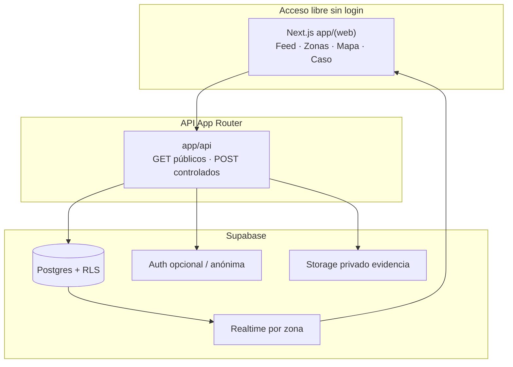

# Red Bibosi — Edición Santa Cruz

**Foro web comunitario estilo Reddit** para reportes vecinales en **Santa Cruz de la Sierra, Bolivia**.  
Acceso **libre y abierto**: cualquiera puede **leer**, ver el **mapa de alertas** y consultar denuncias **sin registrarse**.

> Nombre de la experiencia por zona en este repo: **Cuadra**. El producto / organización: **Red Bibosi**.

---

## 1. Contexto general

| Campo | Definición |
|-------|------------|
| **Proyecto** | Red Bibosi |
| **Concepto** | Plataforma web comunitaria (foro + votos + comentarios + mapa) de reportes vecinales |
| **Ciudad** | Santa Cruz de la Sierra, Bolivia |
| **Acceso** | Lectura y consulta del mapa **sin login**. Publicar / votar puede requerir sesión técnica anónima (ver §6) |

### Propósito

Dar a los cruceños un canal **seguro, centralizado y de libre acceso** para denunciar:

- hechos de **inseguridad**
- fallas de **infraestructura** (p. ej. alumbrado)
- problemas de su **zona**

### Pilar: privacidad y anonimato

| Regla | Detalle |
|-------|---------|
| Denuncias **anónimas** | No se muestra quién publicó |
| **Nunca** se expone | WhatsApp, nombre real, email, foto de perfil identificable u otro dato personal |
| Ubicación pública | Solo **grilla** / zona (`grid_lat`, `grid_lng` o barrio). Coordenadas exactas **solo** en privado (servidor) |
| Evidencia | Storage **privado**; no listar archivos en APIs públicas |

A diferencia de grupos de WhatsApp o redes tradicionales, Red Bibosi **no** convierte al vecino en un dato público.

---

## 2. Estructura de la plataforma

### A. Feed principal (categorías globales SCZ)

Discusiones públicas estilo Reddit; la **votación** da visibilidad a lo más urgente:

| Categoría | Contenido |
|-----------|-----------|
| **Maleantes y robos** | Modus operandi, vehículos sospechosos, alertas de asaltos |
| **Zonas de peligro y alumbrado** | Áreas oscuras, terrenos baldíos, esquinas de alto riesgo, fallas de iluminación |
| **Locales y boliches nocturnos** | Ruido, peleas, incidentes en/fuera de clubes o boliches |

**Regla de establecimientos:** un señalamiento a un local no se publica sin **evidencia** o **3 reportes independientes** (ver [`docs/contracts.md`](docs/contracts.md)).

### B. Discusiones por zona (distritos / barrios cruceños)

Secciones por zona, por ejemplo:

Equipetrol · Plan 3000 · Radial 26 · Villa 1º de Mayo · Urubó · 4to Anillo · (más en seed)

El vecino filtra para ver **en tiempo casi real** lo de su barrio o ruta diaria — sin doxxing ni pin exacto en el mapa público.

---

## 3. Validá este contexto (sí / no)

| # | Afirmación | ¿OK? |
|---|------------|------|
| 1 | Lectura + mapa + listado de denuncias **sin registro**. | |
| 2 | Publicaciones **anónimas** hacia el público (cero WhatsApp / nombre real / PII). | |
| 3 | Feed con 3 categorías: maleantes/robos · peligro/alumbrado · locales/boliches. | |
| 4 | Filtro por zonas reales de Santa Cruz. | |
| 5 | Votos para **visibilidad/urgencia** (estilo Reddit). | |
| 6 | Stack: Next.js + Supabase + Vercel + GitHub Actions; secretos solo en `.env`. | |

---

## 4. Arquitectura (vista de arquitecto)



| Capa | Ruta | Rol |
|------|------|-----|
| UI pública | `app/(web)/`, `components/`, `lib/client/` | Feed, zona, mapa, publicar, seguimiento |
| API | `app/api/`, `lib/server/`, `lib/validation/` | Reglas, rate limit, privacidad |
| Datos | `supabase/`, `tests/rls/` | Schema, RLS, seed de zonas SCZ |
| Tipos | `lib/types.ts` | Contrato TS compartido |
| CI / docs | `.github/`, `docs/` | Actions, contratos, definición |

Hosting: **Vercel**. Datos/Auth/Storage: **Supabase**. Versionado: **GitHub**.

Detalle: [`docs/arquitectura.md`](docs/arquitectura.md) · Definición: [`docs/definicion.md`](docs/definicion.md) · Contrato: [`docs/contracts.md`](docs/contracts.md).

---

## 5. Seguridad y GitHub (cero filtraciones)

1. **Prohibido** hardcodear claves, tokens o credenciales.
2. Secretos solo en `.env` / `.env.local` vía `process.env` / `NEXT_PUBLIC_*` (solo lo público).
3. [`.gitignore`](.gitignore) ignora `.env*`, `node_modules`, builds, `.vercel`, temporales.
4. [`.env.example`](.env.example) lista nombres de variables **sin valores**.
5. Commits: [Conventional Commits](https://www.conventionalcommits.org/) · ramas `feat/…`, `fix/…`, `chore/…`, `docs/…`.

Checklist pre-push:

```bash
git status
git diff --cached          # ¿hay .env o secretos? → SACARLOS
npm run lint && npm run typecheck && npm test
git push -u origin feat/mi-cambio
```

Más: [`CONTRIBUTING.md`](CONTRIBUTING.md) · [`SECURITY.md`](SECURITY.md).

---

## 6. Estado actual vs este contexto

| Requisito del contexto | En el repo hoy | Gap restante |
|------------------------|----------------|--------------|
| Leer / mapa sin login | `GET /api/posts`, `/api/posts/[id]`, `/api/zones`, `/api/map` públicos | Configurar orígenes Auth en dashboard Supabase |
| Denuncia anónima al público | Sin autor en capa pública; `POST` auth opcional + RPC anónima | Activar Anonymous Sign-In en Supabase si se quiere sesión opaca para votos |
| 3 categorías de feed | Mapeo en `lib/client/feed-categories.ts` | UI de filtros por categoría (opcional) |
| Votos tipo Reddit (urgencia) | Voto de corroboración `value: 1` (sigue requiriendo sesión) | Up/down / score — pendiente de contrato |
| Zonas SCZ | Seed con Equipetrol, Plan 3000, Radial 26, Villa 1º de Mayo, 4to Anillo, … | Ampliar según operación |
| Auditoría | [`docs/auditoria-supabase-vercel.md`](docs/auditoria-supabase-vercel.md) | C7–C10 pendientes |

---

## 7. Arranque y versionado (paso a paso)

```bash
git clone https://github.com/Angelitotech23/Red-Bibosi.git
cd Red-Bibosi
cp .env.example .env.local   # completar en local, nunca commitear
npm install
npm run dev                  # http://localhost:3000
```

Flujo seguro a GitHub:

```bash
git checkout main
git pull origin main
git checkout -b feat/nombre-corto
# …cambios modulares…
git add -A
git status                   # confirmar: sin .env*
git commit -m "feat(web): describe el cambio"
git push -u origin feat/nombre-corto
# Abrir PR → main. No force-push a main.
```

Despliegue: conectar el repo en Vercel; Preview por PR; Production desde `main` cuando el owner lo active. Variables sensibles solo en el panel de Vercel / Supabase, nunca en git.

---

## 8. Principios no negociables

1. Acceso libre de **lectura**.  
2. Anonimato y **cero PII** en lo público.  
3. Mapa de **patrones**, no de personas ni pines exactos.  
4. Cero secretos en el código.  
5. Establecimientos: evidencia o corroboración múltiple antes de publicar.

---

Red Bibosi es el canal cruceño donde el barrio se entera a tiempo — sin quemar a quien avisa.
