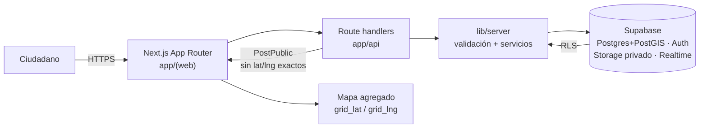

# RED Bibosi

**Plataforma de innovación cívica para Santa Cruz de la Sierra:** conectamos a la ciudadanía con información y respuesta pública en riesgos, transparencia, salud y seguridad — sin vender datos ni exponer a quien reporta.

---

## Por qué existe

Santa Cruz crece más rápido de lo que el Estado local puede escuchar. Los vecinos reportan inseguridad, ruido, acoso o daño en grupos de chat que no escalan a una autoridad con trazabilidad; las instituciones reciben señales tarde, incompletas o imposibles de priorizar. No publicamos aquí cifras que no podamos citar con fuente: el problema que resolvemos es de **canal, evidencia y agregación**, no de marketing del miedo.

Si el reporte no se puede verificar, no sirve para decidir. Si se verifica pero se filtra la identidad o la ubicación exacta, destruimos la confianza que necesitamos para que la gente vuelva a reportar.

## Nuestra apuesta

Ganamos el tramo cívico donde hoy solo hay WhatsApp + planillas: **señales zonales verificables**, con corroboración, evidencia bajo llave y derivación a autoridad con código de seguimiento — y un mapa que muestra patrones, no personas.

No competimos con redes sociales ni con portales genéricos de “denuncia anónima”. Competimos con el vacío entre el rumor de barrio y la mesa de decisión departamental. Ahí el producto que manda es Cuadra (GovSecurity); el resto de tracks reutiliza la misma base de confianza: identidad por pseudónimo, RLS, Storage privado y contratos explícitos.

## Tracks y prioridades

| Track | Resolvemos primero | No haremos todavía |
|-------|--------------------|--------------------|
| **GovSecurity** | Cuadra: reportes por zona, votos, evidencia, seguimiento, mapa agregado | Persecución en tiempo real, doxxing “útil”, ranking de personas o negocios sin gate |
| **GovRisk** | Modelo de alerta ciudadana reutilizando zonas + estados de caso | Centro de comando 24/7 ni integración total con sistemas propietarios de emergencia |
| **GovTransparency** | Publicación de datos abiertos derivados de agregados (sin microdatos) | Scrapers masivos de todo el aparato departamental el día uno |
| **GovHealth** | Señalización de fricción en acceso a servicios (colas, desabastecimiento) por zona | Historia clínica, telemedicina clínica ni datos de pacientes |

**Prioridad de capital y de código hoy: GovSecurity → Cuadra.** Los otros tracks heredan arquitectura; no abren frentes que rompan privacidad o foco.

## Producto actual: Cuadra

Foro ciudadano de **seguridad y convivencia por zona**. Flujo: reportar → verificar (corroboración / evidencia) → opcionalmente derivar a autoridad con **código de seguimiento** → alimentar un **mapa agregado** sin personas ni coordenadas exactas.

| Estado | Qué hay |
|--------|---------|
| **Construido (base en `main`)** | App Router Next.js; API de posts, votos, seguimiento y mapa; schema Supabase + RLS + triggers; UI de zonas, casos, publicar, mapa y seguimiento; cliente con fallback a mocks si la API no está live; CI (lint, typecheck, tests) |
| **Mock / degradación** | Datos y RPC de mapa pueden caer a mocks (`lib/client/mocks`, `lib/server/mocks`) cuando no hay backend configurado |
| **Sigue** | Cerrar contratos pendientes (C-01…C-08), endurecer gate de establecimientos en producción, Realtime por zona, Storage de evidencia end-to-end, métricas de producto cableadas |

Contrato y ownership: [`docs/contracts.md`](docs/contracts.md) · [`docs/ownership.md`](docs/ownership.md).

## Arquitectura en una vista



| Capa | Rol |
|------|-----|
| `app/(web)/`, `components/`, `lib/client/` | UI y cliente |
| `app/api/`, `lib/server/`, `lib/validation/` | API y reglas de servidor |
| `supabase/`, `tests/rls/` | Datos, RLS, seed |
| `lib/types.ts` | Tipos compartidos — no redefinir |
| Vercel + GitHub Actions | Hosting y CI |

## Principios no negociables

1. **Privacidad por diseño** — ninguna respuesta pública con lat/lng exactos ni nombres propios de personas o negocios en texto libre.
2. **Cero secretos en el código** — `.env*` reales fuera de git; solo `.env.example`.
3. **Moderación por evidencia** — un establecimiento no se publica sin evidencia o 3 reportes independientes.
4. **Transparencia de decisiones** — estados de caso visibles; acciones de moderación auditadas; contratos escritos antes que “magia” en el PR.

## Hoja de ruta

| Horizonte | Entrega | Éxito medible |
|-----------|---------|---------------|
| **Ahora** | Cuadra usable en preview: publicar, listar por zona, votar, seguimiento, mapa agregado; CI verde; contratos documentados | Flujos felices en preview sin filtrar PII; `lint` + `typecheck` + `test` en verde en `main` |
| **Próximos 3 meses** | Evidencia en Storage privado; gate de establecimientos en prod; Realtime por zona; primeras derivaciones con autoridad piloto | ≥1 zona piloto con autoridad respondiendo; 0 incidentes de filtración de coords exactas; rate limits activos |
| **12 meses** | Escalado multi-zona SCZ; agregados abiertos (GovTransparency); plantillas de señal GovRisk/GovHealth sobre la misma base | Cobertura de zonas acordada con gobierno local; datasets agregados publicados; reuso de componentes de caso en otro track |

## Métricas que nos importan

No inventamos baselines. Instrumentamos y después fijamos metas.

| Métrica | Cómo |
|---------|------|
| Casos publicados / zona / semana | Conteos desde `posts` con `publish_gate = published` |
| Tasa de corroboración | Votos únicos / posts elegibles |
| Tiempo a primera respuesta oficial | `official_responses.created_at - posts.created_at` |
| % posts de establecimiento bloqueados por gate | `publish_gate` ≠ `published` vs total establecimientos |
| Incidentes de privacidad | Postmortems; objetivo operativo: **cero** filtraciones de coords/PII |
| Salud de entrega | % de runs CI verdes en `main`; tiempo de ciclo PR → merge |

## Cómo arrancar y contribuir

```bash
git clone https://github.com/Angelitotech23/Red-Bibosi.git
cd Red-Bibosi
cp .env.example .env.local   # completa sin commitear
npm install
npm run dev
```

Verificaciones: `npm run lint && npm run typecheck && npm test`.

Convención de ramas: `feat/`, `fix/`, `chore/`, `docs/`. Commits: `feat(api): …`.  
Guías: [`CONTRIBUTING.md`](CONTRIBUTING.md) · [`SECURITY.md`](SECURITY.md) · [`docs/labels.md`](docs/labels.md).

Limpieza de ramas/PRs viejos: propuesta en [`docs/limpieza-pendiente.md`](docs/limpieza-pendiente.md) — **no se ejecuta sin aprobación explícita**.

---

RED Bibosi no es un muro de quejas. Es infraestructura para que Santa Cruz decida con señales que se pueden defender.
