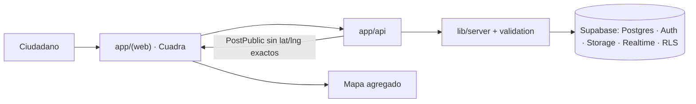

# RED Bibosi

**RED Bibosi** es la plataforma de innovación cívica para Santa Cruz de la Sierra.  
**Cuadra** es el primer producto: un foro ciudadano de seguridad y convivencia **por zona**, donde el reporte se verifica antes de pesar, se puede derivar a una autoridad con código de seguimiento, y alimenta un mapa de patrones — no de personas.

---

## Validá esta idea (sí / no)

Marcá mentalmente cada afirmación. Si alguna está mal, corregila en el PR o en un comentario: el resto del repo se alinea a esto.

| # | Afirmación | ¿Correcto? |
|---|------------|------------|
| 1 | RED Bibosi **no** es solo “denuncias anónimas”: es una plataforma con tracks (GovRisk, GovTransparency, GovHealth, GovSecurity). | |
| 2 | Lo que construimos **ahora** es **Cuadra** (GovSecurity). Los otros tracks reusan la base; no abren producto propio todavía. | |
| 3 | Un caso vive en una **zona** (barrio/distrito). La UI pública muestra grilla (`grid_lat` / `grid_lng`), **nunca** la ubicación exacta. | |
| 4 | Identidad pública = **pseudónimo**, no nombre legal. | |
| 5 | Verificación = **votos de corroboración** y/o **evidencia** (Storage privado). | |
| 6 | Contra un **establecimiento**: no se publica sin evidencia **o** 3 reportes independientes. | |
| 7 | Se puede **derivar a autoridad**; el denunciante sigue el caso con un **código de seguimiento** (se muestra una vez; no se guarda en claro). | |
| 8 | El mapa muestra **agregados / celdas**, no domicilios ni personas. | |
| 9 | Tipos de incidente v1: robo, acoso, vandalismo, consumo en vía pública, convivencia nocturna. | |
| 10 | Estados de caso: reportado → en verificación → corroborado → derivado → resuelto / sin respuesta. | |

Detalle normativo: [`docs/contracts.md`](docs/contracts.md).

---

## Por qué existe

Hoy el vecino reporta en WhatsApp. La señal se pierde, no se corrobora y no llega a una mesa con trazabilidad. La institución, cuando escucha, recibe ruido sin evidencia ni prioridad.

El problema no es “más denuncias”. Es **canal + verificación + agregación** sin quemar a quien reporta.

Si el caso no se puede verificar, no sirve para decidir.  
Si se verifica pero filtramos identidad o coordenadas exactas, nadie vuelve a reportar.

## Nuestra apuesta

Competimos con el hueco entre el rumor de barrio y la decisión pública: **señales zonales que se pueden defender**.

- No somos una red social.
- No somos un buzón de “denuncia anónima” sin reglas.
- Somos infraestructura cívica: pseudónimo, evidencia bajo llave, corroboración, derivación con seguimiento, mapa agregado.

## Tracks — qué sí y qué no

| Track | Ahora | Todavía no |
|-------|-------|------------|
| **GovSecurity → Cuadra** | Reportes por zona, votos, evidencia, seguimiento, mapa | Perseguir personas, ranking de negocios sin gate, doxxing |
| **GovRisk** | Misma base de zonas/estados para alertas futuras | Centro de comando 24/7 |
| **GovTransparency** | Agregados abiertos más adelante | Scrapers masivos día 1 |
| **GovHealth** | Señales de fricción por zona más adelante | Datos clínicos / pacientes |

**Foco de código y capital hoy: Cuadra.**

## Producto actual: Cuadra

```text
Publicar caso (zona + tipo + texto + ubicación)
        ↓
Guardar exacto en privado | público solo en grilla
        ↓
Verificar (votos y/o evidencia)  —  si es establecimiento: gate
        ↓
Derivar a autoridad (opcional) + código de seguimiento
        ↓
Mapa agregado (patrones, no personas)
```

| Estado | Qué hay en el repo |
|--------|--------------------|
| **Hecho en `main`** | Next.js App Router; API (posts, votos, seguimiento, mapa); schema + RLS; UI zonas/casos/publicar/mapa/seguimiento; CI |
| **Degradación** | Sin Supabase configurado, el cliente/API pueden usar mocks |
| **Sigue** | Contratos C-01…C-08, gate de establecimientos en prod, Realtime por zona, evidencia end-to-end, métricas cableadas |

## Arquitectura (una vista)



| Carpeta | Para qué |
|---------|----------|
| `app/(web)/`, `components/`, `lib/client/` | Frontend |
| `app/api/`, `lib/server/`, `lib/validation/` | API y reglas |
| `supabase/`, `tests/rls/` | Datos y RLS |
| `lib/types.ts` | Tipos compartidos |
| `docs/contracts.md`, `docs/ownership.md` | Contrato y dominio por agente |

Stack: Next.js + TypeScript en Vercel · Supabase · GitHub Actions.

## Principios no negociables

1. Privacidad por diseño — sin coords exactas ni nombres propios en lo público.
2. Cero secretos en git — solo `.env.example`.
3. Moderación por evidencia — gate de establecimientos.
4. Decisiones auditables — estados visibles, moderación registrada, contrato antes que improvisar.

## Hoja de ruta

| Horizonte | Entrega | Éxito |
|-----------|---------|-------|
| **Ahora** | Cuadra usable en preview + CI verde | Flujos felices sin filtrar PII |
| **3 meses** | Evidencia, gate en prod, Realtime, autoridad piloto | ≥1 zona con respuesta oficial; 0 filtraciones de coords |
| **12 meses** | Multi-zona SCZ + primers de otros tracks sobre la misma base | Cobertura acordada; agregados publicables |

## Métricas (sin inventar cifras)

| Qué | Cómo |
|-----|------|
| Casos publicados / zona / semana | `posts` con `publish_gate = published` |
| Corroboración | votos únicos / posts elegibles |
| Tiempo a respuesta oficial | `official_responses` − `posts.created_at` |
| Gate de establecimientos | % no publicados vs total establecimientos |
| Privacidad | postmortems; meta operativa = cero filtraciones |
| Entrega | % CI verde en `main` |

## Cómo arrancar

```bash
git clone https://github.com/Angelitotech23/Red-Bibosi.git
cd Red-Bibosi
cp .env.example .env.local
npm install
npm run dev
```

`npm run lint && npm run typecheck && npm test`

Ramas: `feat/` · `fix/` · `chore/` · `docs/` · commits `feat(api): …`  
Más: [`CONTRIBUTING.md`](CONTRIBUTING.md) · [`SECURITY.md`](SECURITY.md) · [`docs/labels.md`](docs/labels.md) · [`docs/limpieza-pendiente.md`](docs/limpieza-pendiente.md)

---

Si la tabla **Validá esta idea** está bien, seguimos. Si no, corregí los puntos falsos: el contrato y el código deben obedecer a esa verdad, no al revés.
